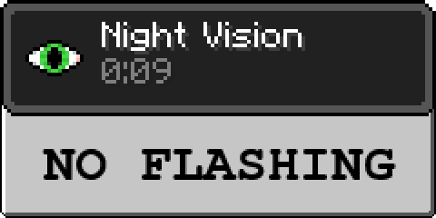

# No Night Vision Flashing — Reborn Initiative

> [!NOTE]
> This project serves as a part of Reborn Initiative. Its primary objectives are restoring compatibility with newer game versions, implementing multiplayer functionality, and generally avoiding introduction of radically new features. All rights to this project belongs to [visualstudiodan](https://github.com/DMHYT).

A mod that removes the flashing effect when night vision effects have less than 10 seconds left
